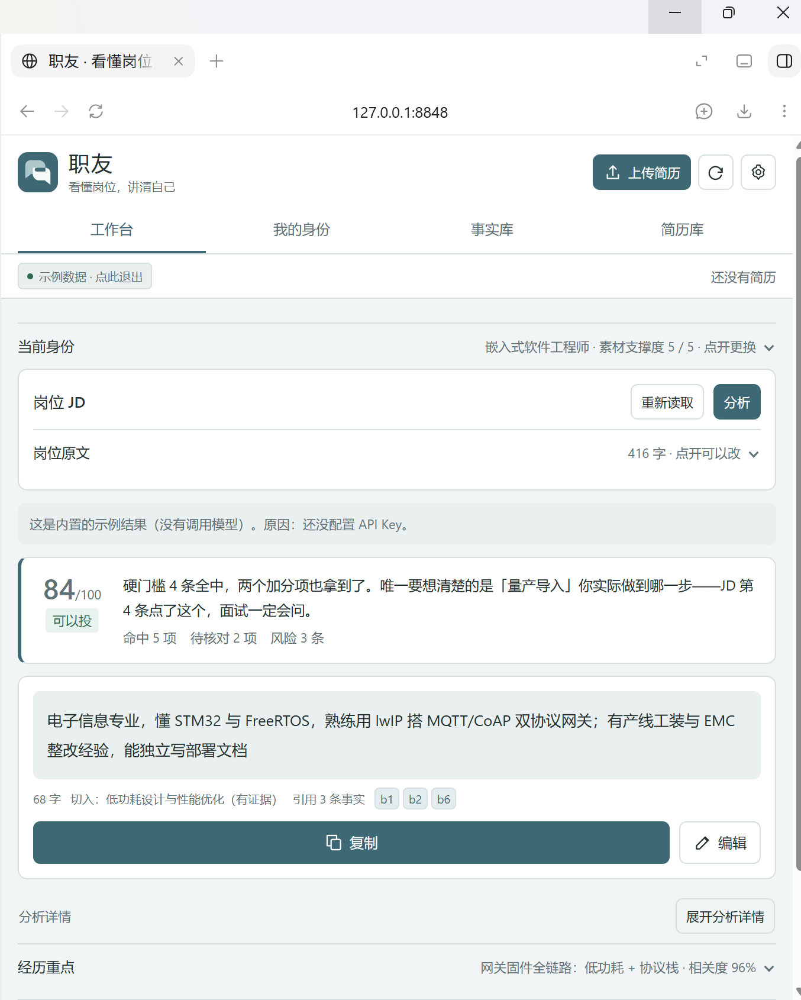
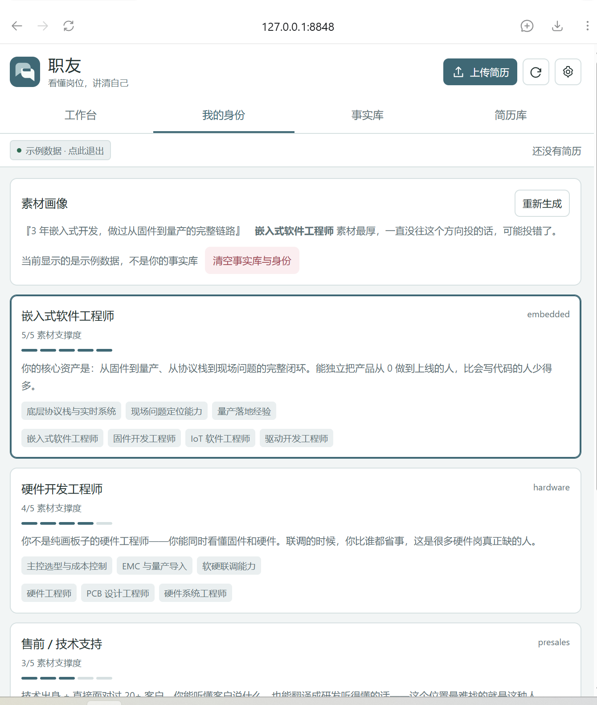
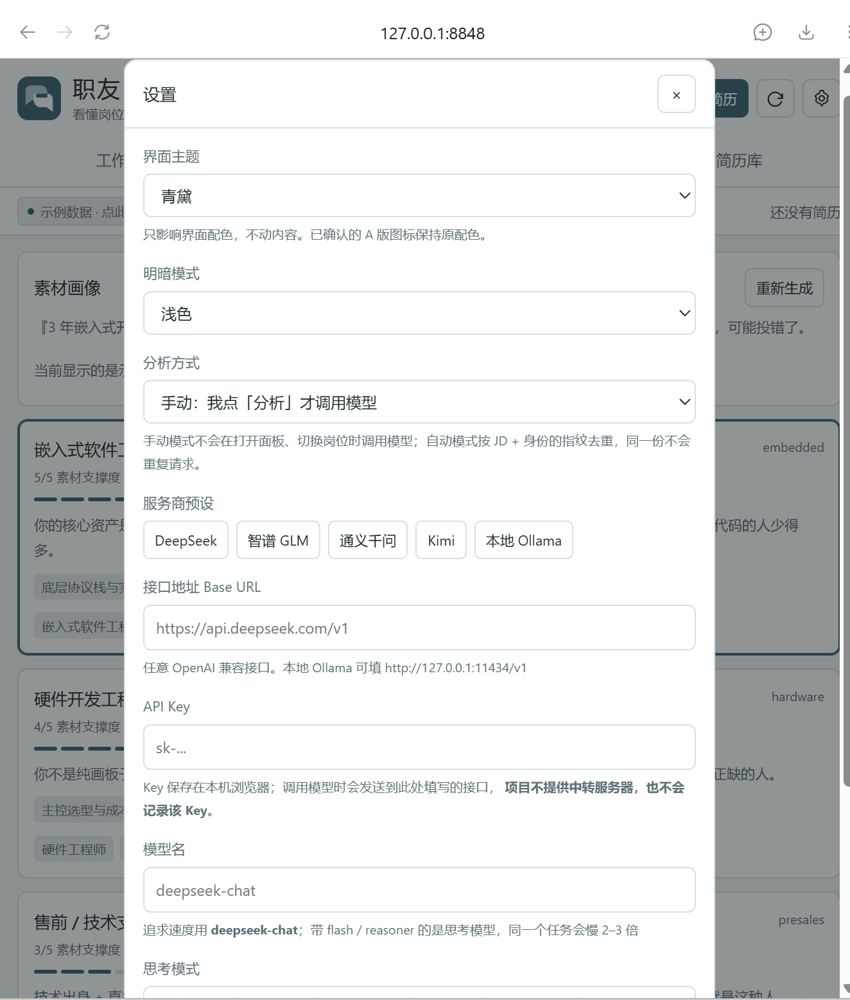

# 职友 · 求职助手

> **看懂岗位，讲清自己。**
>
> 把简历里的真实经历整理成素材，再结合具体岗位，帮你判断匹配点、准备表达。要不要投、最后怎么写，由你决定。

职友是一款适用于 Chrome 和 Edge 的开源求职助手。浏览招聘网页时，它可以读取岗位描述（JD），并基于你的简历素材生成匹配分析、相关经历建议、打招呼语和面试准备提示。

它不自动投递，也不替你编经历。它希望帮你少做重复整理，把时间用在更值得申请的岗位上。



*画面使用内置示例数据，不代表真实用户经历或实际求职结果。*

## 它能帮你做什么

- **一份事实库，多种求职方向**：上传一份或多份简历，整理成可复用的经历与技能素材，再按不同职业方向组织表达。
- **围绕当前 JD 看重点**：展示匹配项、待核对的缺口和风险，帮助你快速检查岗位要求与自己的经历。
- **把素材变成下一步行动**：给出可编辑的经历表达、首条打招呼消息和面试准备问题，可复制后自行修改。
- **招聘页面内完成工作流**：在支持的网站侧边栏查看分析，不用来回切换窗口或手动复制 JD。
- **数据由你掌握**：没有项目账号或项目服务器；简历和设置保存在本机浏览器。使用云模型时，发送给模型服务商的数据范围见[隐私说明](docs/privacy.md)。



## 安装

需要 Chrome 116 或更新版本，或基于 Chromium 的新版 Edge。无需安装 npm 依赖，也无需编译。

1. 从 [GitHub 项目页](https://github.com/h2298511604-ops/zhiyou) 下载并解压 ZIP，或运行：

   ```bash
   git clone https://github.com/h2298511604-ops/zhiyou.git
   ```

2. 在地址栏打开 `chrome://extensions`；Edge 用户打开 `edge://extensions`。
3. 打开页面右上角的**开发者模式**。
4. 点击**加载已解压的扩展程序**，选择项目根目录（其中应能看到 `manifest.json`）。
5. 在浏览器工具栏的扩展菜单中固定「职友」。

安装完成后，点击工具栏里的职友图标即可打开侧边栏。在支持的招聘网站岗位详情页，也可以点击页面右下角的「职友」入口。

## 快速上手

### 1. 配置模型

打开侧边栏右上角的**设置**，选择服务商预设，填写 API Key 并保存，再点**测试连接**。目前提供 DeepSeek、智谱 GLM、通义千问、Kimi 和本地 Ollama 预设；也可以填写兼容 OpenAI API 的接口地址。



若使用 Ollama，先在本机安装并启动 Ollama，再填写接口地址 `http://127.0.0.1:11434/v1` 和本地模型名称。此模式不需要云 API Key；数据发送到你本机运行的模型。

### 2. 添加简历并生成素材

进入**简历库**，上传 PDF、Word（`.docx`）、TXT 或 Markdown 简历，也可以粘贴文本。支持添加多份简历。确认内容后，点击**生成事实库与身份**。

生成过程会把简历文本发送到你在设置中选择的模型服务商。扫描版 PDF 暂不支持 OCR，请使用可选中文本的 PDF，或粘贴简历文字。

### 3. 分析岗位

打开招聘网站的岗位详情页，职友会尝试识别 JD 并填入工作台。点击**分析**查看结果；之后可以编辑、复制，或手动粘贴 JD。

首次打开也可以先点空状态中的**先看一个示例**预览界面。示例使用内置数据，不会调用模型；要分析自己的简历和岗位，需要先配置模型并生成事实库。

## 支持的招聘网站

以下网站会自动尝试识别岗位详情页：

- BOSS 直聘
- 猎聘
- 拉勾
- 智联招聘
- 前程无忧

其它网站不会被常驻读取。你主动在页面使用职友时，可以通过当前标签页权限尝试读取；如果没有识别到 JD，可直接粘贴岗位描述。

## 不想安装扩展？

可以启动本地网页预览（需要 Python 3.8+）：

```bash
python server.py
```

Windows 也可以双击 `start.bat`。启动后打开 <http://127.0.0.1:8848>。本地预览和扩展共用界面；它不是公网服务，请只在本机使用。预览模式的数据保存在当前浏览器中；配置模型后，分析请求会经本机服务转发到你选择的模型接口。

## 隐私与使用边界

- 简历、事实库、设置和 API Key 保存在本机浏览器扩展存储中；网页预览模式使用浏览器本地存储。
- 生成事实库时，简历文本会发往你配置的模型服务商；分析岗位时，JD 和生成所需的简历素材也会发往该服务商。API Key 会作为 Authorization 请求头随请求发送，内容处理方式受对应服务商的隐私政策约束。
- 项目本身不提供账号、数据中转服务器、统计或埋点；扩展不会读取你与招聘方的聊天记录。
- 职友不会自动发送消息或自动投递。生成内容可能有误，请核对原始简历和 JD 后再使用。

完整权限和数据流说明见[隐私说明](docs/privacy.md)。

## 已知限制

- 自动识别主要覆盖上面列出的五个招聘网站；页面改版或其它站点可能需要手动粘贴 JD。
- 扫描版 PDF 暂无 OCR 支持。
- 分析结果用于辅助判断，不代表招聘方结论，也不保证回复率或录用结果。
- 工作台中的生成结果不会作为历史记录保存；需要留存时请先复制。

## 开发与评测

本项目是原生 JavaScript 的 Chrome Manifest V3 扩展。运行规则自检无需 API Key：

```bash
node eval/selftest.js
```

打包扩展运行文件：

```bash
node scripts/package.js
```

命令会重建 `dist/extension/`，该目录可用于加载已解压扩展或制作发布 ZIP。更多实现与行为细节见[功能说明](docs/功能说明.md)，批量评测方法见[评测说明](eval/README.md)。

## 项目文档

- [功能说明与完整使用细节](docs/功能说明.md)
- [隐私说明](docs/privacy.md)
- [评测说明](eval/README.md)
- [问题反馈与建议](https://github.com/h2298511604-ops/zhiyou/issues)

## License

[MIT](LICENSE)
