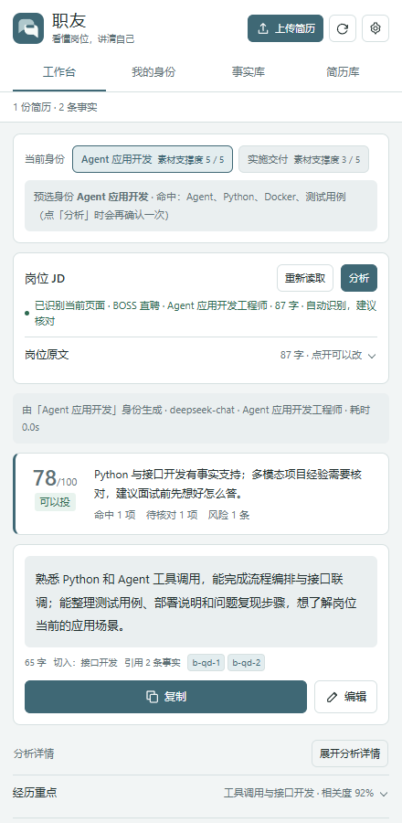
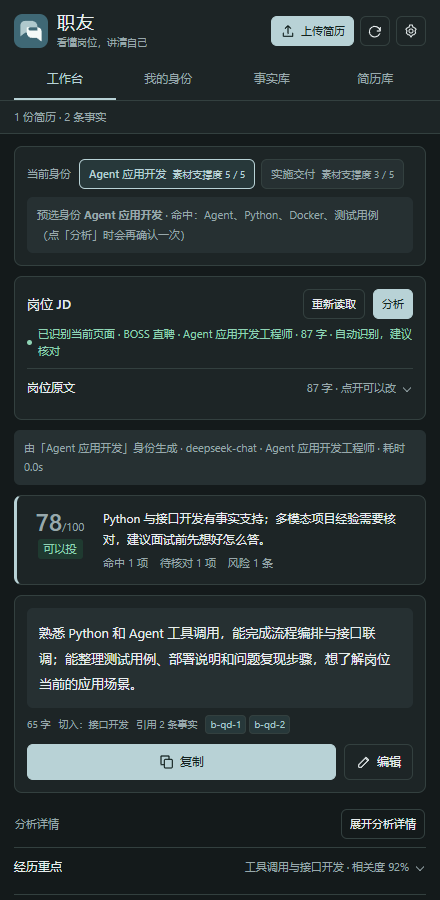
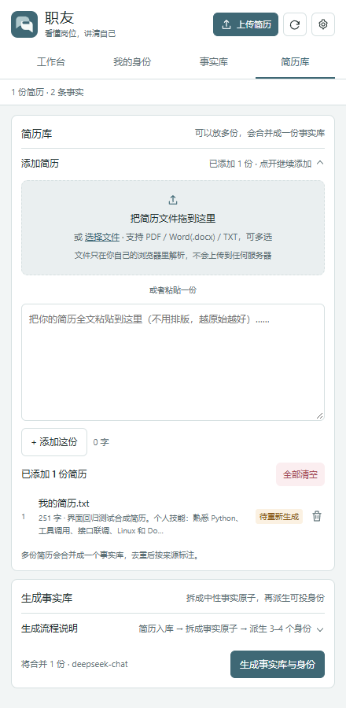
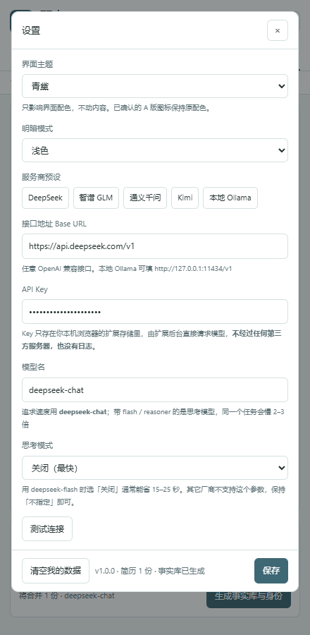

# 职友 · 求职助手

> **看懂岗位，讲清自己。**
>
> 你不需要准备四份简历。你需要一个事实库，和几个身份。

一个 Chrome / Edge 扩展。你在招聘网站刷岗位，它就在右边的侧边栏里，自动读出当前 JD，告诉你：**该不该投、该突出什么、第一句话怎么说。**

它不帮你"编"，它帮你把**已经有的东西说清楚**。



左边是招聘网站，右边是这个面板。不用切窗口，不用复制 JD，不用打开另一个 AI。

招聘页右下角还有一个常驻的悬浮入口，点一下就能开合侧边栏：


<sub>悬浮入口取自 `content.js` 的真实渲染，背景页面为示意。</sub>

深色模式：



---

## 它解决什么问题

你可能正在同时投这几个方向：硬件开发、嵌入式、售前支持、产品经理。

于是你陷入一个死循环：

1. 打开一个岗位 → 2. 读 JD 找关键词 → 3. 回去改简历措辞 → 4. 再想第一句话怎么说
5. 下一个岗位 → 重复 1–4

一天投 20 个岗位，这件事要做 20 遍。而且**四份简历会互相打架**：你今天更新了一段经历，另外三份忘了改。

这个工具做的事，是把这条链路压成一次点击：

```
你维护 1 个事实库（中性的原子事实，写一次）
        ↓
工具自动生成 N 个「身份」（硬件 / 嵌入式 / 售前 / 产品…）
        ↓
你浏览某个 JD，它告诉你三件事：
        ├─ 该不该投（硬门槛命中 / 缺口）
        ├─ 该突出什么（最相关的经历，按当前身份的语言重写）
        └─ 第一句话怎么说（50–90 字，由话术 Skill 驱动）
        ↓
要不要发，你自己决定
```

**目标不是"投更多"，是"投更准"。**

---

## 三个核心概念

### 1. 事实原子库（Fact Base）

事实是中性的，身份是叙事。

**你可以上传多份简历**（比如一份 AI 应用开发、一份 Agent 测试），它们会被合并成**一份**事实库：同一条经历去重、取信息更全的写法，每条事实标注它来自第几份简历。

合并的原因很实际——**一份简历只能撑起一个身份**。你同时投「AI 应用开发」和「Agent 测试」时，两边的素材并不一样，但它们是同一个人的。

同一个项目——「基于 STM32 的智能家居网关」——在不同身份下是四段完全不同的话：

| 身份 | 写法 |
|---|---|
| 硬件开发 | 负责主控与无线模块选型，完成 4 层 PCB 设计与打样，通过 EMC 预测试 |
| 嵌入式 | 基于 FreeRTOS 搭建多任务框架，移植 lwIP 与 MQTT 协议栈，内存控制在 64KB 内 |
| 售前/支持 | 梳理客户现场组网需求，输出 3 类典型场景部署方案，支持 20+ 客户完成接入 |
| 产品经理 | 基于 12 位用户访谈定义 3 个核心场景，输出需求文档，协调软/硬/结构三方 |

**这四段没有一句是编的**，它们只是从不同侧面描述同一件事。这就是「包装」的正当边界：

> 可以重排、可以改写、可以换语言讲 —— **但不能新增事实**。

这也是为什么每条输出都带 `b1`、`b4` 这样的出处标记。点一下就能看到它来自简历的哪一行。

### 2. 身份（Persona）

从事实库里自动推导出 3–5 个可投方向，每个方向给出**素材支撑度**（1–5）。

它经常会告诉你一件你自己没想过的事：

> 你的「嵌入式」素材最强（5/5），但它现在是简历里最弱的部分 —— **你可能一直投错了方向。**

素材支撑度 ≤ 2 的方向，工具会直接说"这个方向 AI 帮不了你，先去补一个最小作品"，而不是硬帮你包装。

### 3. 投影（Projection）

针对某一个具体 JD、在某一个身份下生成的投递方案。**可丢弃、可重生成**，不是一份要保存的简历。

---

## 安装（Chrome / Edge，30 秒）

不需要构建、不需要 `npm install`、不需要装任何依赖。

1. 打开 `chrome://extensions`（Edge 是 `edge://extensions`）
2. 右上角打开 **开发者模式**
3. 点 **加载已解压的扩展程序**，选择这个仓库的根目录
4. 固定到工具栏（拼图图标 → 图钉）

然后：

- 点工具栏图标 → 右侧打开 **侧边栏**
- 或者直接去招聘网站的岗位详情页 → 右下角出现「职友」悬浮按钮 → **点它开 / 关侧边栏**
  （再点一下收起；自己点面板右上角的关闭也行，状态不会错乱，下一次点照样能开）

### 第一次用

1. 侧边栏 **设置** → 选服务商预设（推荐 DeepSeek）→ 填 API Key → 保存
2. **简历库** → 顶栏「上传简历」或展开「添加简历」→ 传文件（PDF / Word / TXT 都行，**可以传多份**，也可以直接粘贴）→ 点「生成事实库与身份」
3. 回去刷岗位，侧边栏会自动识别 JD → 点「分析」

> 第一次打开是**空的**，没有预置示例数据。
> 想先看看它长什么样，点空状态里的「先看一个示例」，看完在状态行点一下就能退出。

> 完全不想花钱：装 [Ollama](https://ollama.com/) 后 Base URL 填 `http://127.0.0.1:11434/v1`，模型名 `qwen2.5:7b`，Key 留空。完全免费，数据不出本机。

### 支持的网站

BOSS 直聘、猎聘、拉勾、智联招聘、前程无忧 —— 这五个站点的**内容脚本是常驻注入**的，打开岗位页就能识别，不用任何操作。

抓取策略是**三级降级**，不依赖单一页面的类名：

```
1. 站点专用选择器      → 快，但改版会失效
2. 关键词 + 文本密度    → 通用算法，找「最紧的那个 JD 容器」
3. 识别失败            → 悬浮按钮变成「未识别岗位」，点开手动粘贴
```

第 2 级是主力。实测在完全陌生的页面结构上也能正确提取（内置测试页用的就是这一级）。

### 其它招聘网站也能用（按需注入）

鱼泡、实习僧、牛客、脉脉…… 这些站点**没有常驻权限**，扩展平时不碰它们。

当你在这些页面上打开侧边栏时，才会通过 `activeTab` 按需注入一次内容脚本，用完即弃。
代价是：如果面板已经开着、你直接切到新标签页，需要点一下工具栏上的扩展图标再点「重新读取」。

这样做是有意的取舍 —— **不开「读取所有网站数据」的常驻权限**，只在你主动使用的那个页面生效。

### 也支持纯网页预览

不想装扩展、只想看效果：`python server.py`（纯标准库，Windows 双击 `start.bat`）→ 打开 http://127.0.0.1:8848

同一份 UI 代码，两种运行方式——扩展侧边栏和本地网页是同一个 `web/index.html`。

---

## 界面

四个页签：

| 页签 | 作用 |
|---|---|
| **工作台** | 切身份 → 贴 JD → 出三层结论（该不该投 / 该突出什么 / 怎么说） |
| **我的身份** | 你的素材能支撑哪些方向，按强度排序 |
| **事实库** | 所有中性事实原子，带证据强度和可量化指标 |
| **简历库** | 上传 / 粘贴 / 删除简历（可多份），也是生成事实库的地方 |

工作台的结构是**先给结论，再给细节**：结论、话术始终在首屏，三组分析详情默认收起，需要时一次展开。

```
┌──────────────────────────────────────┐
│ 职友            上传简历  刷新  设置   │
│ 工作台   我的身份   事实库   简历库    │
├──────────────────────────────────────┤
│ 1 份简历 · 2 条事实                    │
│ 当前身份  [Agent 应用开发 5/5] [实施交付 3/5] │
│ 岗位 JD                重新读取   分析 │
│  ● 已识别当前页面 · 87 字              │
│  岗位原文                 87 字 · 点开 │
├──────────────────────────────────────┤
│  78/100   可以投                      │
│  Python 与接口开发有事实支持，多模态项目经验需要核对 │
│  命中 1 项 · 待核对 1 项 · 风险 1 条    │
├──────────────────────────────────────┤
│  熟悉 Python 和 Agent 工具调用……        │
│  [ 复制 ]            [ 编辑 ]          │
├──────────────────────────────────────┤
│  分析详情              [展开分析详情]   │
│  经历重点      工具调用与接口开发 92% ⌄ │
│  匹配依据      命中 1 项 · 待核对 1 项 ⌄│
│  风险与面试准备 风险 1 条 · 面试 1 问  ⌄ │
└──────────────────────────────────────┘
```



### 主题与外观

界面有 7 套主题，每套支持浅色 / 深色 / 跟随系统，在设置页切换，选择会保存：

| 主题 | 主色 | 气质 |
|---|---|---|
| **青黛**（默认） | `#3F6875` | 低饱和的青灰，偏工具 |
| 石墨灰 | `#414B5A` | 中性，最安静 |
| 鼠尾草 | `#4B6B53` | 灰绿，温和 |
| 雾海蓝 | `#3C6D83` | 偏灰的海蓝 |
| 陶土红 | `#9B5C46` | 温暖的红棕 |
| 暖砂金 | `#7E6A42` | 米色与暖棕 |
| 莓酒红 | `#7D4658` | 偏冷的酒红 |



切换主题只改颜色，不重绘内容——正在编辑的话术、已展开的详情、页面滚动位置都不会丢。
品牌色（青黛）和状态色（绿=命中 / 琥珀=待核对 / 红=风险）是分开的，不会混用。

### 图标

扩展图标是 A 版「并肩对话」轮廓：青黛底 `#3F6875`，后层气泡 `#AFC8CC`，前层气泡 `#F5FAF8`。

矢量源是 [`icons/zhiyou-qingdai.svg`](icons/zhiyou-qingdai.svg)，PNG 由它生成，不手绘、不单独维护：

```bash
node scripts/make-icons.cjs          # 重新生成 16 / 32 / 48 / 128
node scripts/make-icons.cjs --check  # 只校验现有 PNG 与 SVG 是否一致
```

页面品牌区、favicon、招聘页悬浮入口用的都是同一份轮廓。

---

## 一个我认为最重要的设计

### 把「包装」从赌博变成准备

现在的求职市场，不包装根本没人理 —— 这是现实，装看不见没有意义。

所以这个工具不劝阻包装，而是**把每一处"说过头"的地方都标出来**：

```
┌────────────────────────────────────────────┐
│ 中风险  参与过一次批量异常复盘                │
│    原文：参与客户投诉的技术复盘               │
│    面试可能追问：「参与」具体指什么？          │
│                  你推动了哪些决策？           │
└────────────────────────────────────────────┘
```

然后给出一份 **面试必问清单**，告诉你哪几处会被追问、该怎么准备。

**用户要的是"敢投"，不是"敢骗"。** 告诉他哪里虚，反而让他更有底气。

### 打招呼语由「话术 Skill」驱动

不是求职信，是聊天窗口里的第一条消息。

`web/skills/greeting.js` 里放的是**本人真实发出去、并拿到回复的话术样本**。每次生成时整段 Skill 注入 prompt —— 模型不是在"创作"，是在模仿这个人的写法：

```
身份锚点 + 硬能力  →  具体工具/动作  →  可交付物  →  JD 明写的条件

电子信息专业，懂 Linux 与网络排障，熟练用 Docker 部署环境、看日志定位问题；
有硬件焊接调试基础，能独立写排障文档和 SOP；接受出差
```

几条硬约束（写死在 Skill 里）：

| 规则 | 原因 |
|---|---|
| **素材只从简历的「个人优势 / 个人技能」段来** | 项目里的 trace_id、P95、覆盖率这类细节，HR 读不懂 |
| **开头那个词必须来自 JD** | JD 写「计算机相关专业」时，用「电子信息专业」开场等于自曝短板 |
| **只学结构，不学句子** | 和样本连续 8 个字重合就重写 |
| 动词只用 懂 / 熟悉 / 熟练用 / 精通 / 擅长 / 有…经验 / 能独立 | 后面必须紧跟具体技术名 |
| 必带一个**可交付物** | 「能写文档和 SOP」让 HR 觉得你不用带 |
| 结尾补一条 **JD 明写的条件** | 「接受出差」这类，JD 没写就不加 |
| 50–90 字，硬上限 100 | 再长 HR 不读 |

Skill 里还存了 **简历原文 → 话术成品** 的压缩对照，这是风格的本质：

```
简历原文：独立完成 STM32 检测系统的原理图设计、PCB 绘制、焊接与调试，
　　　　　也能完成软件服务的 Docker 部署、环境检查与日志排障。…接受项目短期出差。

压缩成：　电子信息专业，懂 Linux 与网络排障，熟练用 Docker 部署环境、看日志定位问题；
　　　　　有硬件焊接调试基础，能独立写排障文档和 SOP；接受出差
```

删主语、删"独立完成"这类铺垫，只留「专业身份 + 技术名 + 一个动作结果」。

**想让它更像你**：往 `examples` 里加自己的真实话术，`version + 1`，刷新面板即可生效，不用改代码。

> **fork 的人注意**：`web/skills/greeting.js` 里的 `examples` / `pairs` 是**原作者的真实话术**，不是通用规则。
> 换成你自己的，否则模型会模仿别人的口气。规则部分（骨架、开头怎么定、专业放不放、结尾）才是通用的。

反例（AI 味典型）：`您好，我是具有三年经验的嵌入式开发工程师，精通 STM32F4、FreeRTOS 与 lwIP 协议栈，擅长低功耗设计与性能优化……` —— 每句话都在形容自己，没有一句在说做过什么。

---

### 身份是自动选的，不用你点

打开一个岗位，它把 JD 和每个身份自己的素材（岗位名 / 叙事重点 / 项目技能）做词频匹配，**自动切到最对口的那个**，并写出命中了哪些词。

匹配用分层加权 + IDF：岗位名的词权重最高，叙事重点次之，项目技能最低；同时被多个身份共用的通用词（Python、Agent、交付）会被降权——否则所有岗位都会匹配到「实施交付」。

实测（4 个身份 × 4 个岗位）：

| JD | 选中身份 | 分差 |
|---|---|---|
| AI Agent 开发工程师 | Agent 开发工程师 | 37 vs 13 |
| RAG 检索评测工程师 | RAG 检索与评测 | 40 vs 8.5 |
| AI 实施交付 | AI 实施/交付 | 26.6 vs 0 |

### 关于速度

| 因素 | 影响 |
|---|---|
| **模型是否开思考** | 最大头。DeepSeek flash / reasoner 默认开启、effort=high，单次多花 15–25 秒 |
| 输出长度 | 已压到 2 条 highlight / 3 条面试预案，并要求每条不超过 40 字 |
| 输入长度 | 只发当前身份用到的 bullet |

设置里有「思考模式」开关：选「关闭」会给请求带上 `{"thinking":{"type":"disabled"}}`（[DeepSeek 官方参数](https://api-docs.deepseek.com/zh-cn/guides/thinking_mode/)）。其它厂商不认这个参数，保持「不指定」。

---

### 批量回归测试（开发用）

调 prompt 不能靠「这条看着不对」，那是过拟合。用真实 JD 批量跑，看哪几条判错。

量尺在 [`eval/`](eval/)，是个独立项目——删掉整个目录，插件照常工作：

```bash
# 0. 自检：验证评测器本身是准的，不花 token
node eval/selftest.js

# 1. 建 eval/.env.local，写一行 DEEPSEEK_API_KEY=sk-xxx
# 2. 先跑 20 条看看（--limit 0 是全量）
node eval/run-synth.js --limit 20
```

结果写到 `eval/out/`（csv + json + 一份汇总 txt）。汇总里给两个关键数字：

```
有可疑缺口的 JD：N 条（M 条缺口），说明模型在编门槛
话术里出现 JD 没有的条件：K 条
```

**这两个数字才是调 prompt 的客观依据**——它们下降，才说明幻觉真的少了。

评测怎么分层、怎么防过拟合，见 [`eval/README.md`](eval/README.md)。

---

## 它明确不做的事

| 不做 | 原因 |
|---|---|
| **自动发送 / 自动投递** | 决定权永远在你手里。这也是这个工具能长期存在的前提 |
| **上传简历到服务器** | 没有服务器。所有数据只存在你本机的浏览器存储里 |
| **读取你的聊天记录** | 只读岗位详情页的 JD，不碰你和 HR 的对话 |
| **承诺提升回复率** | 无法验证的事不承诺。它承诺的是"省时间"，不是"包拿 offer" |
| **编造不存在的经历** | 背调、面试、社保记录，三处都能穿帮 |

---

## 技术实现

```
manifest.json          # MV3
background.js          # Service Worker：模型代理 + 侧边栏控制（无日志、不落盘）
content.js             # 内容脚本：JD 识别 + Shadow DOM 悬浮入口
web/
  index.html           # 侧边栏 UI（同时也是本地网页版，同一份代码）
  style.css            # 7 套主题 × 浅色/深色/跟随系统，全部走 CSS 变量
  app.js               # 主逻辑（运行时判断扩展环境 / 网页环境）
  prompts.js           # 3 个核心 prompt（挖料 / JD 解析 / 投影）
  demo.js              # 示例数据（只在点「先看一个示例」时载入，用完可退出）
  files.js             # 简历解析：PDF(pdf.js) / docx(浏览器内置解压) / txt
  vendor/              # pdf.js 本地打包（MV3 禁止远程加载脚本）
  skills/greeting.js   # 话术 Skill（规则 + 真实样本）
icons/
  zhiyou-qingdai.svg   # 图标矢量源，PNG 由它生成
scripts/
  make-icons.cjs       # SVG → 16/32/48/128 PNG（4×4 超采样，无外部依赖）
  package.js           # 打包：只把扩展运行需要的文件拷进 dist/extension
server.py              # 可选：纯标准库本地预览服务
```

### 为什么模型请求走后台 Service Worker

扩展的 `host_permissions` 让它发起的 `fetch` **不受 CORS 限制**。所以侧边栏不直接请求模型，而是：

```
侧边栏 → chrome.runtime.sendMessage → Service Worker → fetch(模型 API)
```

好处是智谱这类**没开 CORS** 的接口也能用（实测：DeepSeek / 通义 / Kimi 开了 CORS，智谱没开）。

自定义接口域名不在 `host_permissions` 里时，保存设置会弹一次授权（`optional_host_permissions`）。

### JD 识别是三级降级

```
1. 站点专用选择器            快，但改版就失效
2. 关键词命中 + 祖先容器收敛   ← 主力，不依赖类名
3. 识别失败                  → 「未识别岗位」，点开手动粘贴
```

第 2 级的做法：用 XPath 找含「岗位职责 / 任职要求 / 职位描述…」的文本节点，向上收敛到一个「装得下但不过大」的容器，再向下裁剪到「覆盖 85% 文本」的最内层子元素。这样不认类名也能拿到正确的那一块。

SPA 路由变化靠 `pushState/replaceState` 补丁 + `popstate` + 定时比对 URL 三重兜底。

### 三段式 pipeline（不是一个巨型 prompt）

```
简历原文 ──[LLM]──▶ 事实原子库 + Persona 列表
                              │
JD 原文 ──[LLM]──▶ 结构化分析（硬门槛 / 加分项 / 套话）
                              │
                              ▼
                    [LLM] 投影 → 三层输出 + 风险 + 面试预案
```

关键约束写死在 prompt 里：

1. **只输出 JSON**，字段固定，便于前端渲染和校验
2. **每条生成必须带 `bulletId`**，对不上事实库的内容直接丢弃
3. **硬门槛必须能在 JD 原文里逐字指出**：`why` 字段要求原样引用 JD 那一行。指不出来的不算门槛 —— 不许拿推测、惯例、或者自己拼出来的组合条件（比如 JD 只写"本科及以上在读"，却写成"仅限大二或研一"）去劝退用户
4. **「建议跳过」有代码兜底**：每条缺口会和 JD 原文做二字切片重合度校验，低于 35% 的直接标「JD 原文里找不到这条要求，可能是我编的」；如果所有缺口都没通过，会在结论卡上方提示「判跳过的依据一条都没找到，请自己核对」
5. **打招呼语禁用词表**：渴望、十分、非常荣幸、不胜感激、恳请、希望得到这个机会……

---

## 路线图

- [x] 事实库 + 多身份 + 投影
- [x] **Chrome / Edge 扩展：Side Panel + 页内悬浮入口 + JD 自动识别**
- [x] **简历文件上传：PDF / Word(.docx) / TXT，本机解析**
- [x] **多份简历合并成一个事实库（去重 + 标注来源）+ 简历库管理**
- [x] **v1.0：职友品牌 + 青黛图标 + 7 套主题 + 折叠式分析详情**
- [ ] 公开评测集：50 组脱敏的 JD × 简历 × 人工标注参考话术
- [ ] 列表页匹配度角标（扫一眼就知道哪些值得点开）
- [ ] 「其实我符合」反馈学习：纠正模型的误判
- [ ] 事实库导出 / 导入（换电脑、多设备）

---

## 隐私

- 简历和 API Key **只存在你本机浏览器的扩展存储里**（`chrome.storage.local`）
- 模型请求由扩展后台直接发出，**不经过任何第三方服务器**
- 没有账号、没有埋点、没有统计，也不会上传你的 JD 或简历
- 唯一有权访问的域名：你填的模型接口，以及你主动浏览的那几个招聘网站

完整说明见 [`docs/privacy.md`](docs/privacy.md)。

---

## 免责声明

本项目仅用于辅助个人求职，**不提供任何自动化投递或绕过平台风控的功能**。
使用者需自行遵守目标招聘平台的服务条款。生成内容请务必自行核对，因使用生成内容产生的任何后果由使用者自行承担。

---

## License

[MIT](LICENSE)
